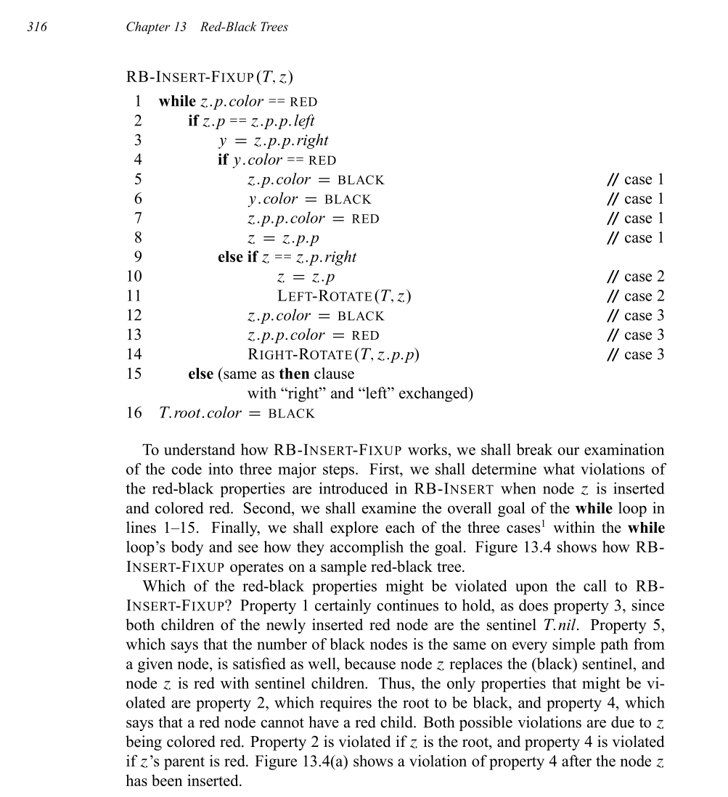
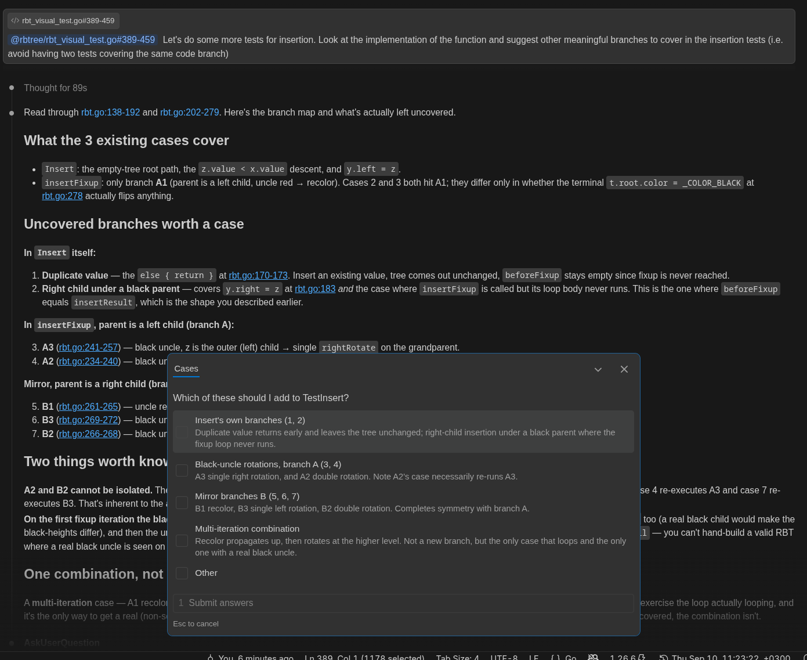
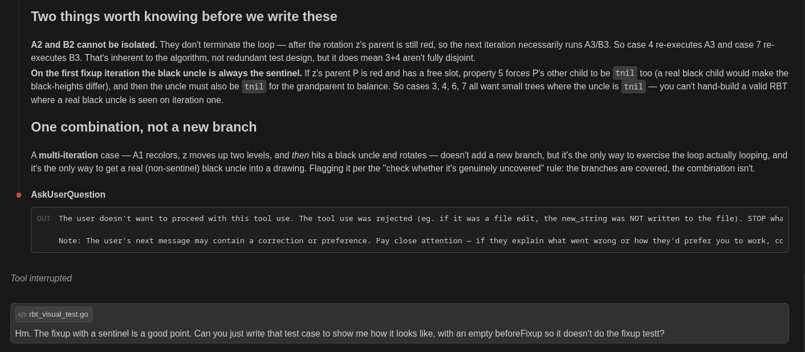
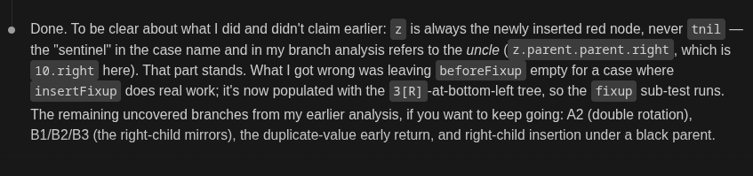

# How to test a data structure

I think by far one of the most important parts of implementing `rbtree` was having a proper way to test the implementation. This is not only for making sure that future changes are not breaking my library, but also to make sure the implementation is correct in the first place. The reason for choosing a red-black tree over a regular binary search tree in the first place is so that you benefit of the logarithmic complexity of the operations achieved by rebalancing the tree during writes. Therefore, you need some way to test that your tree is indeed balanced.

However, this is not really as straightforward as simply giving it a sequence of inserts and deletes and comparing the result with an expected tree. That may be easier with some other data strucutures because the result is more predictable (e.g. with sorted sets, it's very easy to  visualize how the result should look like, and checking that is' actually sorted is straightforward). Visualizing the end result of a binary search tree is really hard because the rebalancing part performed during inserts and deletions is a bit like black magic. In fact, even for a regular binary search trees it is not immediately obvious during a deletion how the tree will end up looking like.

On top of this, how do you actually perform the comparison? Specifying the result of a sorted list is as simple as writing the elements in a regular array and calling `sort` at the end, but you don't really have a simple way of actually writing the resulting tree you're expecting in a test, because you need to manually write all the node connections yourself. Practically, this is unfeasible with large trees (at least, it is for me with the limited time I have to develop this). Even thinking about all possible scenarios you have during an insert or deletion operation is kind of difficult simply because there's so many cases to consider. Plus, you will always ask yourself the question, "have I covered all cases?" (although this is greatly mitigated by knowing that these structures have been studied for years).

This is where constraints come in.


Let's talk about what it means for a binary search tree to actually satisfy the red black tree properties. But first we need to understand the binary search tree properties:

```
    1
   / \
  2   13
 / \   \
4   6   19
```

Above we have a tree data structure, but it's not actually a binary search tree. However, the one below, is:

```
    6
   / \
  2   13
 / \   \
1   4   19
```

For a tree to satisfy the binary-search-tree property, all left children to the root of any subtree must have a value smaller than the root, and all right children a greater value. Note that this is a recursive property, so the following also doesn't satisfy the binary-search-tree property due to the subtree rooted at 19:

## Testing for correctness

Let's dive into correctness a bit more. So far, I kind of implied that your testing approach looks something like this:

- Start with a set of inputs;
- Apply the operation on that set of inputs;
- Evaluate the result of the operation against an expected result.

This is very basic but also a good description of how most unit test cases are set up. Let's be honest, you probably just want to pass that coverage requirement, don't you? While I find it suitable for reasonably simple logic, it becomes tricky for Red-Black tree operations. To put it into perspective, here's how the insert implementation [looks like](https://en.wikipedia.org/wiki/Red%E2%80%93black_tree#Insertion). The book that I've been reading dedicates 6 pages just to explain the rebalancing procedure you may or may not need to execute at the end of the insertion. Here's a snippet. 

Sure, having to read through this isn't the worst thing in the world (remember those C++ snippets from earlier?). Nonetheless, it's complex enough to wrap your head around and inevitably doesn't give me enough confidence that I have a sufficient number of test cases to cover all branches. In theory, those are finite (textbook classifies it in 3 cases) but not in the sense that each test input will pass through one of these 3 cases. Rather, the intermediary state during an insertion can be one of these 3 cases. Rebalancing is done in a loop, so there are insertion operations that can fall through all cases, some multiple times. Even if you re-write the code so that you can individually test every rebalancing case, it still leaves the open question of what inputs are suitable for complete insertion tests.

As if this weren't enough, there's some additional considerations which I won't cover in depth, but affect how you should design your test suite. You can read more at the end. But perhaps the one worth pointing out separately is that, while the implementation of the insertion operation is (or at least should definitely be) deterministic, there are multiple valid rebalancing implementations, some more efficient than others. The same input can produce different valid trees under different rebalancing algorithms, meaning that a test suite like this isn't portable.

At this point, I suggest to start approaching tests differently. Let's take a step back to think about what being a Red-Black tree actually means. All you need to become one is satisfying a set of invariants (constraints):

0. It must satisfy the binary search tree property
1. The root is black
2. Every node is colored either red or black
3. Every leaf (TNIL) is black.
4. If a node is red, then both its children are black
5. For each node, all simple paths from the node to descendant leaves contain the same number of black nodes.

If that's you, congrats! You're a Red-Black tree now 🌞

Like I said, I won't go into details about these properties. The important bit is the result they provide: _the tree is approximately balanced_. This effectively allows for implementations of write and read methods that run in logarithmic time with respect to the number of nodes in the tree. On a higher level, it offers a means to implement a collection of sorted elements efficiently.

The nice thing about constraints is that they must hold after every write on a Red-Black tree. This is a substantial benefit when designing a test suite, because _we no longer need to worry about explicit tree inputs and outputs_. [4] In the beginning, I showed how you generally use a tree:

```go
func main() {

	// define a tree
	t := rbtree.NewRBT[int]()

	// do some writes on the tree with values coming from somewhere
	t.Insert(2)
	t.Insert(6)
	t.Insert(13)
	t.Insert(1)
	t.Insert(4)
	t.Insert(19)

	// ...
}
```

Focusing on constraints enables us to define tests following a similar pattern. After every operation, we just assert that the resulting structure is a Red-Black tree, without having to visualize its shape. We could come up with a testing sequence that looks something like this:

- Generate a random list of (unique) elements;
- Insert every element into the tree;
- Check the constraints hold after every insertion;
- Remove every element from the tree, maybe in a different order;
- Check the constraints hold after every removal.

Turns out, you can validate the constraints in a single tree traversal. Below, you can find the algorithm that I'm using:

```go
func assertRBTProperties[T cmp.Ordered](t *testing.T, tree *RBT[T]) {
	t.Helper()

	if tree == nil {
		panic("assert called on nil tree")
	}

	// nothing to assert here
	if tree.Size() == 0 {
		return
	}

	if tree.Root() == nil {
		panic("nil root")
	}

	if tree.Root().color != _COLOR_BLACK {
		t.Fatal("property 2 violation: root should be black")
	}

	var walk func(n *RBTNode[T], bnCount int, lo, hi *T)
	bnCountTarget := -1 // unset
	walk = func(n *RBTNode[T], bncount int, lo, hi *T) {

		if n.color != _COLOR_RED && n.color != _COLOR_BLACK {
			t.Fatal("property 1 violation: found a node with an invalid color")
		}

		if n.isSentinel() {
			if n.color != _COLOR_BLACK {
				t.Fatal("property 3 violation: sentinel node should be black")
			}
			// if we haven't explore any simple path to TNIL yet, set it as the
			// target to compare to. Otherwise, compare it against an existing
			// target since the black node count must match.
			if bnCountTarget == -1 {
				bnCountTarget = bncount
			}
			if bnCountTarget != bncount {
				t.Fatal("property 5 violation: found two paths with different black length")
			}
			return
		}

		v := n.Value()
		if lo != nil && v <= *lo {
			t.Errorf("bst violation: %v is in the right subtree of %v", v, *lo)
		}
		if hi != nil && v >= *hi {
			t.Errorf("bst violation: %v is in the left subtree of %v", v, *hi)
		}

		if n.color == _COLOR_RED &&
			(n.left.color != _COLOR_BLACK || n.right.color != _COLOR_BLACK) {
			t.Fatal("property 4: found red node whose children aren't both black")
		}

		if n.color == _COLOR_BLACK {
			bncount += 1
		}

		walk(n.left, bncount, lo, &v)
		walk(n.right, bncount, &v, hi)
	}

	walk(tree.Root(), 0, nil, nil)
}
```

And there you go! Knowing these constraints hold after every operation should give you a high degree of confidence that your implementation is correct.

Or, should it?...

## The problem with constraints

At first glance, I would say the approach above is quite convincing that my tree is correct. At least, I was convinced in the beginning. Though we are overlooking quite a few things if we just leave it like this.

It's necessary to highlight the part where I say "allows for implementations". On their own, these constraints only define valid tree structures on an abstract level. Modelling that representation in code **does not automatically mean that your operations actually run efficiently!** To give an analogy, even if you have a list of sorted numbers, nothing stops you from searching one sequentially. This article will not cover performance tests more in depth, but you should definitely consider adding them to your test suite.

Therefore, testing constraints alone isn't a good enough proof of an efficient implementation. Still, we can leverage them to have a good enough proof of a correct implementation. 


Focusing on constraints enables us to define tests following the same pattern. After every operation, we just assert that the resulting structure is a Red-Black tree, without having to visualize its shape. However, be mindful that testing constraints alone **isn't a substitution for testing the public API**, but rather a complement. To give a concrete example, here's how they could work together:

- Generate a random list of (unique) elements;
- Insert every element that has an even position in the list;
- Check the constraints hold after every insertion;
- Assert that searching all elements with even positions in the input list returns a valid node, and those with odd positions return null.

A good testing sequence will highly depend on the methods and parameters of your public interface, though. In my case, insertions don't return anything and reads return a node pointer [5], so the setup above makes sense. Consider appropriate adjustments based on your situation. If the tree accepted duplicates, have some duplicates in the input. If the insertion method returns output parameters, test them out. There's just so many ways to play around and explore with the design of your interface [6], so have some fun with it:)


Taking a step back to the Red-Black tree library tests. There is an efficient way to validate the 6 original constraints using a single tree traversal. This gives us a lot of flexibility in our tests, since we now can write tests on large randomized sets of inputs. Validating the public interface works as expected combined with the fact that the shape of the tree is correct gives me plenty of confidence in the testing suite.

If you're interested, here is the algorithm to validate the constraints:

(insert code)

Also, this is the shape of the tests:

(insert code)


What I love about constraints is that you can use them to infer other constraints. For Red-Black trees, one particularly interesting one is that a subtree rooted at a node `x` contains at least `2^bh(x) - 1` internal nodes, where `bh` is the black height of the node. In turn, this implies that the height of any Red-Black tree is at most `2*lg(n+1)`, where `n` is the number of nodes. That gives you more possiblities when deciding which sets of constraints you might want to validate in your tests, because some may have more efficient algorithms to check or may simply be easier to write. Just be careful when testing a different set of constraints than the original ones, as **they must imply the original set of constraints**. Just satisfying the height property alone **does not** imply a tree is a Red-Black tree.

> I like math a lot, so I like to think of the starting constraints as some axioms that define a space where you can play around and explore its properties. It's just amazing how many new things you can deduce starting from just a few statements that we label as true. Strictly speaking, there's more to it than just the starting 6 axioms. You could go even further and ask yourself, "What does a tree, a node or a child actually mean?" but here I find it important to be practical. As long as the underlying language used to define these "axions" is the same for everyone (e.g. it is clear what a child node means), then the constraints are a good starting point to explore.

## Additional considerations

- Coming up with test cases and understanding what happened is still difficult, even with visual tests. Can you tell what happened in the test below?

```go
		{
			name: `the recoloring moves the violation up to a red parent whose own
			uncle is black, so the fixup loops and then rotates`,
			value: 5,
			tree: `
            50[B]
          v---+---v
        25[R]   75[B]
      v---+---v
    15[B]   35[B]
  v---+---v
10[R]   20[R]`,
			beforeFixup: `
               50[B]
             v---+---v
           25[R]   75[B]
         v---+---v
       15[B]   35[B]
     v---+---v
   10[R]   20[R]
    /
  5[R]`,
			insertResult: `
               25[B]
         v-------+-------v
       15[R]           50[R]
     v---+---v       v---+---v
   10[B]   20[B]   35[B]   75[B]
    /
  5[R]`,
		},
	}
```

- I'm not sure if every structurally valid Red-Black tree can be reproduced using a random sequence of insertions and deletions, at least with the algorithm that I'm using. One might argue an input like that does not constitute a valid test case, though personally I think it should.

- Constraints do prove the correctness of your internal representation. They don't necessarily prove the correctness of the methods you expose via your interface.

- We still care about test inputs in general and how we generate them. And I still think you should have some tests on explicit inputs.

5 -  this is subject to change

6 - you can decide between being more thorough in your tests, but they can never be fully correct. and it also obviously depends on how expensive it is to test the result. you want to be practical





		{
			name: `the value's uncle is the sentinel, so the fixup recolors and
			rotates right around the grandparent`,
			value: 3,
			tree: `
   10[B]
    /
  5[R]`,
			insertResult: `
    5[B]
 v---+---v
3[R]   10[R]`,

good job fucking opus 5. I was writing them with sonnet and now I regret spending more quota.

but to be honest I also read it wrong. ADHD meds hadn't kicked in yet.



agent's pretty bad at things for example it was always saying that left and right subtrees
must have the same black height, which is untrue


----


        https://github.com/golang/tools/blob/master/cover/profile.go
        https://github.com/golang/tools/blob/master/cover/profile.go#L233