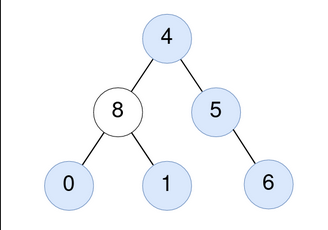
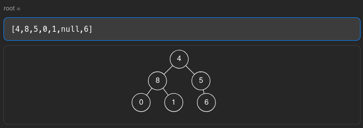
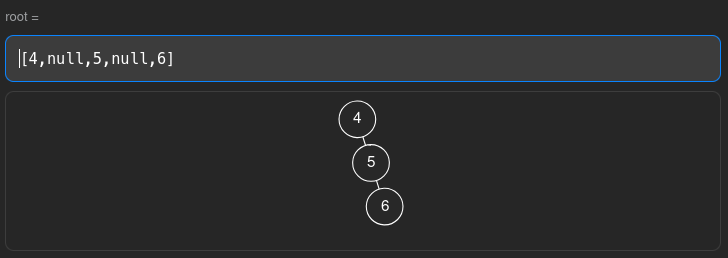

# Constraint-based testing

Before you read this, I want to emphasize that this article isn't some practical guide for how you should write library tests, or testing tips in general. In fact, knowledge of basic testing practices is a prerequisite. It's rather about how I went around some challenges when writing my Red-Black tree library. If you came here for a tutorial, sorry but this isn't for you.

This article also isn't about the theory and implementation behind Red-Black trees. No need to leave if that scares you;) Ok, let's get into it then.

For a while I've been working on a Red-Black tree library, and I kind of wanted to talk about one part of building it that I found annoying, interesting and challenging at the same time. Of all things, when you're looking an efficient data structure module, arguably what you care about most is correctness. I mean, ergonomics and performance don't really mean much when the code is not working as expected. A good part of my development effort went into the testing suite. Actualy, most of it really, since the algorithms are a [textbook](https://www.cs.mcgill.ca/~akroit/math/compsci/Cormen%20Introduction%20to%20Algorithms.pdf) rip-off, though you can find them pretty much everywhere.

Since you want correctness, it means you want _a lot_ of tests. And that came with a problem.

## Writing down a tree

Let's start with how you'd typically use a binary tree. I'd say most cases are summarized by:

```go

func main() {

	// define a tree
	t := rbtree.NewRBT[int]()

	// do some writes on the tree with values coming from somewhere
	t.Insert(2)
	t.Insert(6)
	t.Insert(13)
	t.Insert(1)
	t.Insert(4)
	t.Insert(19)

	// work with the tree, i.e. go through nodes
	explore(t.Root())

	// maybe more writes, more work
}
```

Well, at least kinda. This is obviously oversimplified and your code most likely never looked like this. What I wanted to show here is the lifecycle of the object. 

However, there's actually a good chance you used a tree-like data structure in your code, just not directly. In "real world" use-cases, they're a common tool powering other abstractions. The [std::map](https://en.cppreference.com/cpp/container/map) and [std::set](https://en.cppreference.com/cpp/container/set) C++ containers are implemented as Red-Black trees and I would argue there is production code out there with sets and maps. Those have a different API, but the operations happening behind these abstractions use a "tree-like" API. Just have a look at C++'s [std::set](https://github.com/gcc-mirror/gcc/blob/b1263bca56ea82e555ddccf6729042a25805580c/libstdc%2B%2B-v3/include/bits/stl_set.h) implementation which uses this [Red-Black tree](https://github.com/gcc-mirror/gcc/blob/b1263bca56ea82e555ddccf6729042a25805580c/libstdc%2B%2B-v3/include/bits/stl_set.h#L137) right here to see for yourself. Of course, that's assuming you can even read that shit. I kept looking at the set file for a while and wondering, "where's the fucking set, though?"

> To be "that guy", it's actually `gcc`'s implementation and it's actually [this](https://github.com/gcc-mirror/gcc/blob/b1263bca56ea82e555ddccf6729042a25805580c/libstdc%2B%2B-v3/include/bits/stl_tree.h) Red-Black tree. Have a look at the [insertion code](https://github.com/gcc-mirror/gcc/blob/b1263bca56ea82e555ddccf6729042a25805580c/libstdc%2B%2B-v3/include/bits/stl_tree.h#L764). That's a total of 307 underscores!

As a side note, I personally have use cases where I use trees directly, which is when I do coding problems and [trees](https://github.com/Ozoniuss/Algorithms/commit/5d8d7f809c220913afab2c51a5feb266cd53e2ad) happen to show up. In those cases my code does look similar to the snippet, but typically only implementing the "work with the tree, i.e. go through nodes" part. Yeah, I find a lot of joy in figuring out if I want to go left or right. What I don't find a lot of joy in though (at least with leetcode), is the "do some writes on the tree with values coming from somewhere" part, because getting those values from their inputs to test my stuff locally has to be at least as complicated as writing the actual solution to the problem.

Most of the time, your input looks something like this:



Here, it comes from [this](https://leetcode.com/problems/count-nodes-equal-to-average-of-subtree/) problem. This is perfectly reasonable, as long as you represent it with an image. That's not the case in your code, though. Leetcode weren't kind enough to provide the implementation of an `Insert` method like I have in my sample. Instead, it ends up looking something like this:

```go
func() Tree[int] {
	root := &BSTNode[int]{value: 4}
	l := &BSTNode[int]{value: 8, parent: root}
	r := &BSTNode[int]{value: 5, parent: root}
	ll := &BSTNode[int]{value: 0, parent: l}
	lr := &BSTNode[int]{value: 1, parent: l}
	rr := &BSTNode[int]{value: 6, parent: r}
	root.left = l
	root.right = r
	l.left = ll
	l.right = lr
	r.right = rr
	return &BST[int]{root: root, size: 6}
}()
```

This is only 6 nodes, by the way. And you don't even need to specify the color of a node, like in a Red-Black tree.

I think at this point you're starting to realize the direction I'm going to. Even for relatively small trees, this representation totally lacks clarity. Even though you could argue having to write this may not be a pain in the ass anymore now with AI, there's still no way you can give someone that snippet and have them understand how the tree looks like. You can imagine why for tests, this becomes quite a significant downside. Or, you could of course argue that reading code (particularly tests) isn't a problem anymore either nowadays.

Admittedly, there's ways to simplify writing these inputs. One example is writing it as a list, which is how LeetCode provides them:

```
root = [4,8,5,0,1,null,6]
```

Also, to give them some credit, you can now edit the inputs and see the tree with a visualizer:



This representation is much more compact, but it still has the same downside of lacking clarity. I was actually surprised the first time I saw how `[4,null,5,null,6]` looks: 



I suppose eventually, you'd get used to whatever representation you use most commonly. But there's no denying that images are simply a much, much better representation of a binary tree input. I actually ended up [writing one](https://github.com/Ozoniuss/ds/blob/8ca58b28055dfc3b02b78dea8a271187d7cab0f8/rbtree/format.go#L73) so that I can have visual tree representations in my source code! Here's a snippet from how my [test suite](<https://github.com/Ozoniuss/ds/blob/8ca58b28055dfc3b02b78dea8a271187d7cab0f8/rbtree/rbt_visual_test.go)>) looked like at some point:

>  Here I'm testing transplant(u, v) which overwrites node u with node v, using table-driven testing. Note that transplant can leave the tree in an invalid state. 

```go
func TestTransplant(t *testing.T) {

	type testcase struct {
		// testcase definition
	}

	cases := []testcase{
		// ...
		{
			name: "u is the right child of its parent and v is an internal subtree",
			u:    30,
			v:    5,
			initialTree: `
       20[B]
     v---+---v
   10[B]   30[B]
 v---+---v
5[R]   15[R]`,
			transplantResult: `
      20[B]
     v--+--v
   10[B]  5[R]
 v---+---v
5[R]   15[R]`,
		},
		// ...	
	}

	for _, tc := range cases {
		t.Run(tc.name, func(t *testing.T) {
			// check initial tree looks as expected after transplant
		})
	}
}
//
```

I'll be covering how it works in a future article. I find this a significant step up in terms of clarity but still, wasn't good enough for me to be satisfied with how much it proves correctness. On top of it, you actually need to, well, write these inputs:) No wonder AI generates all your test cases now. When you start to think a bit more about it, I'm basically paying a bunch big-ass corporate monopolies to write test cases for my open source library. I prefer not to think about it.


Let's dive into correctness a bit more. So far, I kind of implied that your testing approach is something like this:

- Start with a set of inputs;
- Apply the operation on that set of inputs;
- Evaluate the result of the operation against an expected result.

This is very basic but also a good description of how most unit test cases are set up. Let's be honest, you probably just want to pass that coverage requirement, don't you? While I find it suitable for reasonably simple logic, it quickly becomes tricky for Red-Black tree operations. To put it into perspective, here's how the insert implementation [looks like](https://en.wikipedia.org/wiki/Red%E2%80%93black_tree#Insertion). The book that I've been reading dedicates 6 pages just to explain the recoloring procedure you may or may not need to execute at the end of the insertion. Here's a snippet. 

Sure, having to read through this isn't the worst thing in the world (remember those C++ snippets from earlier?). Nonetheless, it's complex enough to wrap your head around and inevitably doesn't give me enough confidence that I have a sufficient number of test cases to cover all scenarios. In theory, those are finite (textbook classifies it in 3 cases) but not in the sense that each test input will pass through one of these 3 cases. Rather, the intermediary state during an insertion can be one of these 3 cases. There are insertion operations that can pass all cases, some multiple times. Even if you re-write the code so that you can test each insertion step, there still is the question of what your inputs would be to the parent insertion operation.

As if this weren't enough, there's some additional problems which I won't cover in depth, but raise important considerations about how you should design your test suite:

- The visual trees add clarity in representation. They don't necessarily add clarity in understanding what the hell happened after the insert. (add image) [what happened there](https://github.com/Ozoniuss/ds/blob/8ca58b28055dfc3b02b78dea8a271187d7cab0f8/rbtree/rbt_visual_test.go#L579)
- I'm not sure if every structurally valid Red-Black tree can be reproduced using a random sequence of insertions and deletions, at least with the algorithm that I'm using. One might argue an input like that does not constitute a valid test case, though personally I think it should.

But perhaps the one worth pointing out separately is that, while the actual implementation of the insertion operation is deterministic, there are multiple valid rebalancing implementations. The same input can produce different valid trees under different rebalancing algorithms, meaning that a test suite checking the output of a certain input isn't portable if you want to change your implementation say, to a more efficient one.

At this point, I suggest to start thinking about these tests differently. Particularly, the Red-Black tree definition only defines a set of invariants (constraints) that must hold after every operation.


So for this reason, it's time to take a step back and look at what it actually means to be a red-black tree:

1. The root is black
2. Every node is colored either red or black
3. Every leaf (TNIL) is black.
4. If a node is red, then both its children are black
5. For each node, all simple paths from the node to descendant leaves contain the same number of black nodes.

And on top of this, you want to also satisfy the binary search tree property. Because yeah, there is such thing as a binary tree that is not a binary search tree.

> The terminology barrier I had to deal with when implementing this was just so fucking insane. Like why the fuck does a red black tree's height have to be different from a binary search tree's height?? (I mean, I know why. But still.)

We call these constraints. It's like a specification, kind of like C++. You heard about people implementing C++ in C++. That's because it's a misleading statement. C++ is just a specification. It describes how implementations of the language like gcc should behave.

This is also why the insert operation can have different valid outcomes in a specific scenario. Both actually satisfy these constraints.

These constraints are actually the most important part of a red-black tree data structure. They're arguably much more important than which valid output you choose to return in the operation, assuming you aren't an idiot and have implemented the operation efficiently. And most importantly, constraints don't care about the actual shape of the tree, as long as they're satisfied. Therefore, it kind of makes sense to want to focus your tests around these constraints, because it allows you to generate arbitrary insertion sequences, and validate after every insertion that you're still satisfying the constraints. This actually gives me quite a lot of confidence (todo: talk about inserting random trees and whether or not you cross all insertion paths).

One additional advantage of this test suite is that it's actually portable to any red black tree implementation. It doesn't matter which insertion outcome you choose when there's multiple ones. If I ever change the existing implementation to favor a more efficient one, the result of the operation may change, but I don't need to change the entire test suite.

However, there was still a small part of me that worried all those random sequences would not cover all code branches. I think it's still useful to try to have explicit tests for all your code branches and the trivial cases. This is why I eventually wrote the visual test suite.


I think by far one of the most important (and challenging) aspects of implementing `rbtree` was having a proper way to test the implementation. Obviously, testing isn't something specific to a library providing an implementation for a data strucutre. I will be talking about unit tests in this article and I strongly recommend having a comprehensive testing suite (including unit tests) for any kind of module you want to implement. However, I find that specifying "proper" test cases can largely differ based on what you're trying to prove. For a tree implementation, having to actually specfiy the tests is quite difficult.

The most ubiquitous approach to testing the implementation of a method is, roughly:

- Start with a set of inputs;
- Apply the operation on that set of inputs;
- Evaluate the result of the operation against an expected result.

This seems pretty easy, until you actually try to supply the input and expected output for a tree. Let's try to see how this looks like for a tree that only has two nodes:

```go
func() Tree[int] {
	root := &BSTNode[int]{value: 4}
	l := &BSTNode[int]{value: 8, parent: root}
	r := &BSTNode[int]{value: 5, parent: root}
	ll := &BSTNode[int]{value: 0, parent: l}
	lr := &BSTNode[int]{value: 1, parent: l}
	rr := &BSTNode[int]{value: 6, parent: r}
	root.left = l
	root.right = r
	l.left = ll
	l.right = lr
	r.right = rr
	return &BST[int]{root: root, size: 6}
}()
```

I mean, yeah. Good luck trying to figure out the shape of the tree from this example. On top of this, there's the risk that the tree you specify like this is actually invalid. I bet you haven't noticed that `l3` does not hold a value that satisfies the binary-search-tree property, have you? On top of this, imagine if you actually wanted to test the structure of the tree (i.e. that the nodes have the correct pointers to parents or children). Check links specifically of have another tree as a comparison? You can see how easily this can get messed up.

So you may think as an alternative, let's just provide a list of nodes to insert to 

And the worst part is, this has only 3 nodes.

The reality is, all of these methods lack clarity when specifying the actual tree you want to test. It isn't really easy for a developer to dive into the test cases and understand how the tree looks like before and after the operation. In fact, ended up writing an algorithm to create a string representation of a tree and even in that case, it's still a bit difficult to understand what is going on during the rebalancing process.


Of course, even with randomly generated inputs, there is a question of whether or not you have enough coverage. The write operations all have 6 [non-trivial cases](https://en.wikipedia.org/wiki/Red%E2%80%93black_tree#Implementation) so I think it's healthy to approach the problem with a bit of skepticism in regards to whether or not these randomized tests provide full coverage. I mentioned before that specifying explicit test cases is difficult, but I don't actually think it's a strong enough reason to omit these tests from your test suite. Because this implementation has been well-studied for years, I did end up including a case for each branch of the implementation. I will cover these in a future article.

## Appendix: algorithm used to test the implementation

1. The root is black
2. Every node is colored either red or black
3. Every leaf (TNIL) is black.
4. If a node is red, then both its children are black
5. For each node, all simple paths from the node to descendant leaves contain the same number of black nodes.

These can all be checked using a single traversal of the tree. I don't think I need to go into details about the first four though, since the implementation is trivial. Property 5 is more interesting since when processing a node, it requires information about all descendants of that node.

Additionally, by definition a red-black tree also satisfies the binary-search-tree property, which is more interesting to test out. The mental model here is similar to property 5: essentially, checking every node requires having information about all descendant nodes, since you need to prove that all children on the left side have a smaller value than the node, whereas all children on the right side have a larger value. The kind of traversal that works for this is called a postorder traversal, meaning you essentially process the parent after you processed both children, potentially using a result surfaced by processing the children. This could look something like the below:

```go
func explore(node *rbtree.RBTNode[int]) int {
	if node == nil {
		return
	}

  // gather results from the exploration
	maxleft := explore(node.Left())
	maxright := explore(node.Right())

	// use the results (note that maxleft and maxright may be set to
  // something)
  return max(maxleft, maxright, node.Value())
}
```

Another thing to consider here is that

In some cases you may want to only write tests through the public methods exposed by your module. For example, you could re-write this test if your data structure exposes an iterator and a method to return the list's length. I think that is perfectly fine, as long as you can prove the internal representation looks like you expect. Generally, I think a proper testing suite should include tests for the internal methods anyway.


The reason for choosing a red-black tree over a regular binary search tree in the first place is so that you benefit of the [logarithmic complexity ](https://en.wikipedia.org/wiki/Red%E2%80%93black_tree#Properties) of the operations. This is achieved by rebalancing  Therefore, it's essential to prove that the implementation of the rebalancing operation is proper in the first place.

Fundamentally, the tests you want to write still follow the typical pattern of starting with a test input, performing an operation (e.g. an insertion or a deletion) on that input and then comparing the output of that operation with an expected output. The main problem is that there's isn't much clarity into how the test inputs and test outputs actually look like.

However, this is not really as straightforward as simply giving it a sequence of inserts and deletes and comparing the result with an expected tree. That may be easier with some other data strucutures because the result is more predictable (e.g. with sorted sets, it's very easy to  visualize how the result should look like, and checking that is' actually sorted is straightforward). Visualizing the end result of a binary search tree is really hard because the rebalancing part performed during inserts and deletions is a bit like black magic. In fact, even for a regular binary search trees it is not immediately obvious during a deletion how the tree will end up looking like.

On top of this, how do you actually perform the comparison? Specifying the result of a sorted list is as simple as writing the elements in a regular array and calling `sort` at the end, but you don't really have a simple way of actually writing the resulting tree you're expecting in a test, because you need to manually write all the node connections yourself. Practically, this is unfeasible with large trees (at least, it is for me with the limited time I have to develop this). Even thinking about all possible scenarios you have during an insert or deletion operation is kind of difficult simply because there's so many cases to consider. Plus, you will always ask yourself the question, "have I covered all cases?" (although this is greatly mitigated by knowing that these structures have been studied for years).

This is where constraints come in.

## Constraints

There's a difference between a binary tree and a binary tree that satisfies the "binary-search-tree" property. Have a look at the following example:

```
    1
   / \
  2   13
 / \   \
4   6   19
```

The above shows a binary tree but one that doesn't satisfy the binary-search-tree property. The one below, having the same set of values as nodes, however does:

```
    6
   / \
  2   13
 / \   \
1   4   19
```

These trees are not considered the same.

For a tree to satisfy the binary-search-tree property, all left children to the root of any subtree must have a value smaller than the root, and all right children a greater value. Note that this is a recursive property, so the following also doesn't satisfy the binary-search-tree property due to the subtree rooted at 19:

```
    6
   / \
  2   19
 / \   \
1   4   13
```

For the remainder of this article, when saying "binary search tree" I will refer to binary trees that satisfy the binary-search-tree property. Operations are implemented such that the result of every write preserves the binary-search-tree property. Therefore, we call this property a constraint of the binary search tree data structure.

For a tree to satisfy the red-black properties, it must satisfy the binary-search-tree property, together with the following ones:

1. The root is black
2. Every node is colored either red or black
3. Every leaf (TNIL) is black.
4. If a node is red, then both its children are black
5. For each node, all simple paths from the node to descendant leaves contain the same number of black nodes.


Property number 3 may be a bit confusing: basically, each leaf is considered to have two TNIL children that are both black. The reasoning for this becomes clearer when combined with property 4, which under this interpretation allows leaves to be colored red. TNIL nodes also simplify the implementation of operations, which we won't get into here.

Unfortunately, TNIL nodes also complicate some definitions. The height of each node gains an extra 1, because the leaf nodes are considered TNIL.

I'm also getting a headache whenever I say the word leaf node but I actually want to refer to an internal leaf, not the imaginary TNIL leaf. Frankly, I find having to deal with this new terminlogy pretty fucking retarded. While I was reading through the textbook I had such a hard time figuring out when I should consider TNIL nodes, "nodes".

Throughout this article, "internal node" will mean any node that is part of the tree that isn't a TNIL leaf node. When talking about leaves, I will explicitly use "TNIL leaf" and "internal leaf" for clarity.

I also won't really go much into what these properties mean. TLDR, they allow tree operations to happen in logarithmic time when satisfied. The only thing important to understand here is that they must hold after every tree operation, which gives us a set of constraints. Unlike explicitly testing that some operations produced a particular tree, constraints give us something much more flexible: regardless of the input and the sequence of operations, the constraints must always hold. Therefore, we can shift our testing strategy to something like, let's randomly generate a bunch of trees and operations and after every operation we can test that the red-black properties still hold.

In order to achieve this, we need a mechanism to actually test these properties. Turns out, we can build one that only requires a single tree traversal.

Let's explore how, starting with the "binary-search-tree" property. Basically, we need to check that for each node, all its left children have a smaller value and all its right children have a larger value. Intuitively, this algorithm works as follows:

- Define `explore()`


One particularly interesting insight here is that, even though we're actually exploring every single node once, we're doing several kinds of tree traversals in the same exploration code. 

```go
func explore(node *rbtree.RBTNode[int]) {
	if node == nil {
		return
	}
	// do something with the parent before exploration
	fmt.Println("before", node.Value())

	explore(node.Left())
	explore(node.Right())

	// do something with the parent after exploration
	fmt.Println("after", node.Value())
}
```


    
- another appraoch here is actually reading a tree from a predictable formatting method.

On top of that, a tree has many valid representations. but given the library code is deterministic, the same sequence of operations would always result in the same tree.


- small state testing, where you insert up to 6 nodes and check all possible trees (which is something like 2^64)


		{
			name: `the value's uncle is the sentinel, so the fixup recolors and
			rotates right around the grandparent`,
			value: 3,
			tree: `
   10[B]
    /
  5[R]`,
			insertResult: `
    5[B]
 v---+---v
3[R]   10[R]`,

good job fucking opus 5. I was writing them with sonnet and now I regret spending more quota.

but to be honest I also read it wrong. ADHD meds hadn't kicked in yet.


agent's pretty bad at things for example it was always saying that left and right subtrees
must have the same black height, which is untrue


			name:  "the value is already in the tree, so the insertion is a no-op",
			value: 5,
			tree: `
   10[B]
 v---+---v
5[R]   15[R]`,
			insertResult: `
   10[B]
 v---+---v
5[R]   15[R]`,
		},


        https://github.com/golang/tools/blob/master/cover/profile.go
        https://github.com/golang/tools/blob/master/cover/profile.go#L233